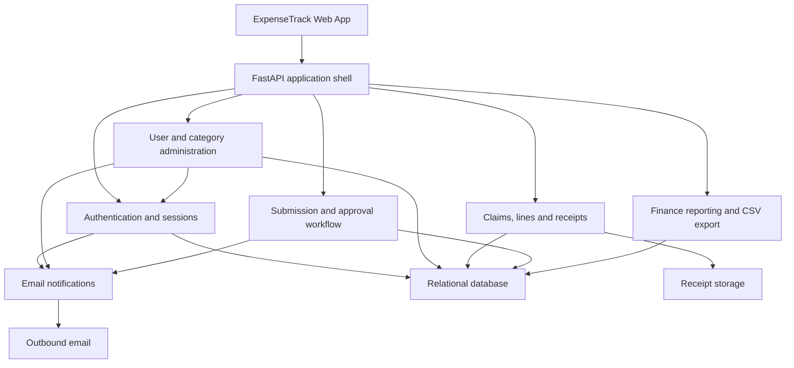
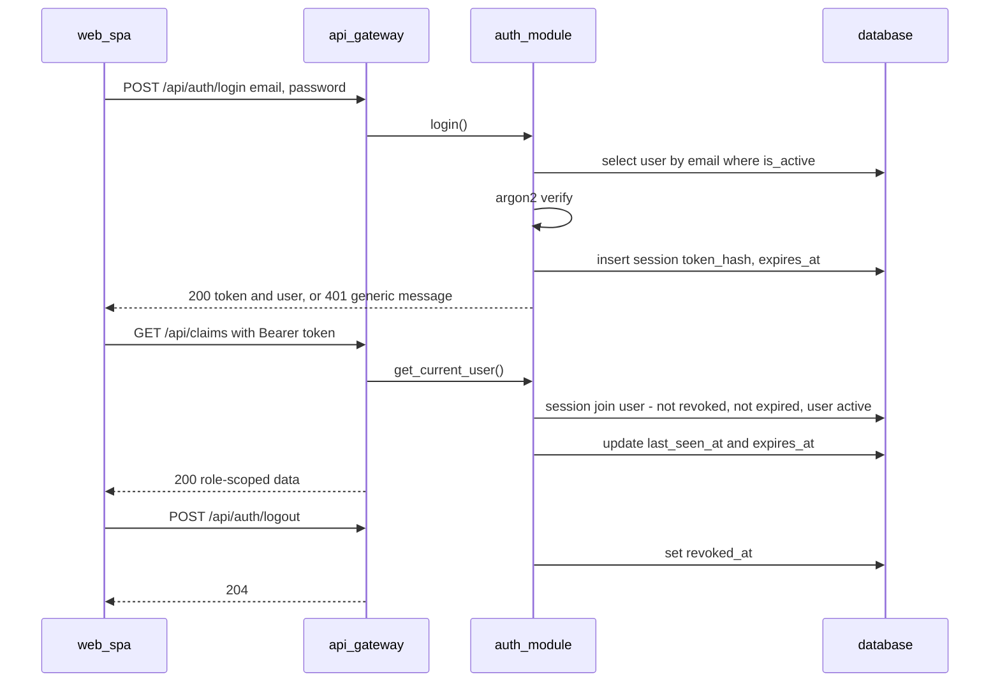
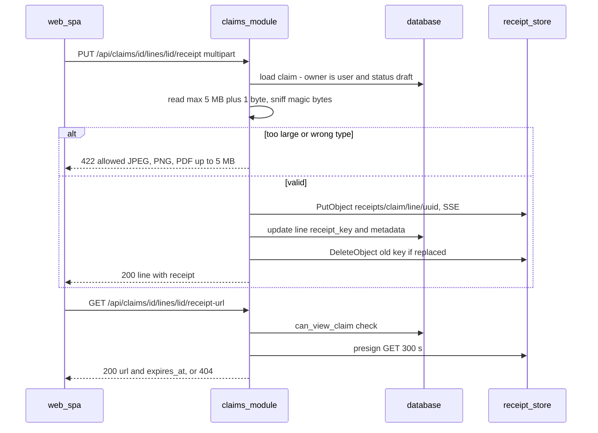
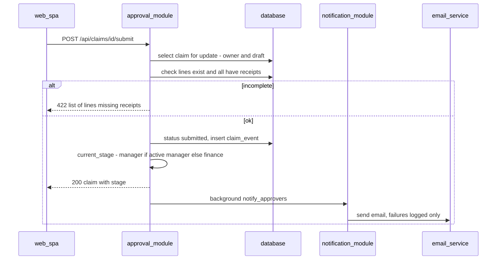
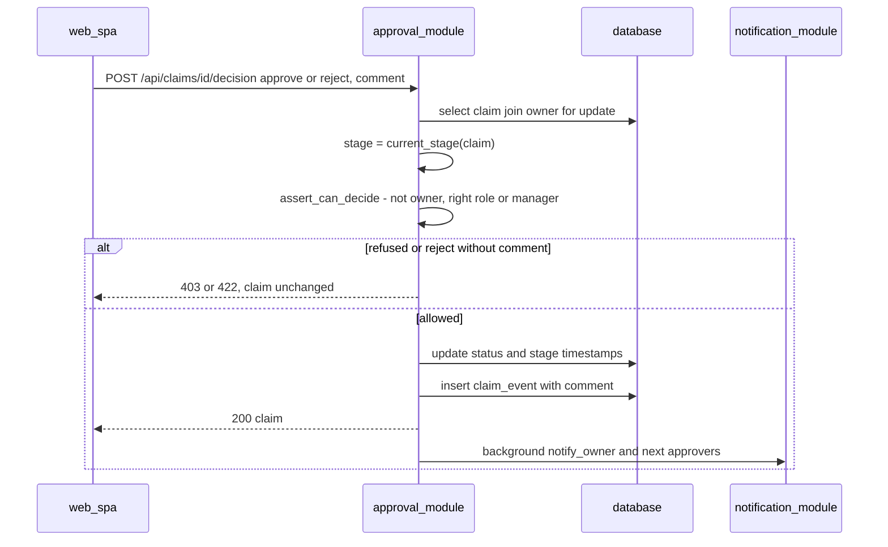
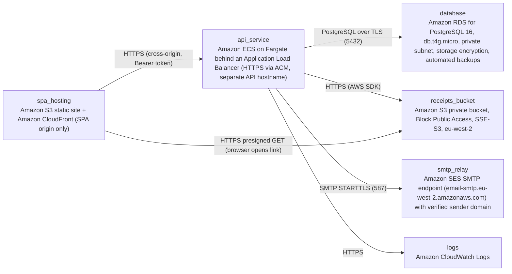

# Architecture

> Maintained by QuorQ AI SDLC. Text between `sdlc:auto` markers is regenerated; anything outside them is yours and is kept.

<!-- sdlc:auto:start narrative -->
## Overview

### ARCH-OVERVIEW · approved · source: architecture:v1

ExpenseTrack is an internal expense-claims web app for a 5–50 person UK company. It is a React 19 SPA plus a single FastAPI 0.115 API on PostgreSQL 16, all hosted in AWS eu-west-2. No infrastructure is added beyond the approved services.

- Status: approved. Version: 1.
- SPA and API run on separate origins.
- Region: AWS London (eu-west-2) to meet UK GDPR.
- Receipts:
  - JPEG, PNG or PDF, up to 5 MB.
  - Streamed through the API and checked before storage.
  - Stored in a private S3 bucket.
  - Viewed only via 5-minute presigned links.
- Email:
  - Covers password reset, submission and decision notifications.
  - Sent via the approved SMTP server, pointed at the SES eu-west-2 SMTP endpoint.
  - Sent in the background, so failures never block a claim.
- Auth:
  - Email and password, with Argon2 hashing.
  - Server-side sessions with an opaque bearer token.
  - Sign-out, idle expiry, password reset and deactivation all revoke sessions server-side.
- Approval workflow (one server-side module):
  - Two-stage routing: assigned manager, then Finance.
  - Manager stage is skipped if the submitter has no active manager.
  - Self-approval is blocked at every stage, including mark-paid.
  - Every status change goes to an append-only audit table.
- Over-limit flags, Finance totals by category and month, and the CSV export are plain PostgreSQL queries.

**Related:** ARCH-DEC-APPROVAL-ROUTING, ARCH-DEPLOY, ARCH-DATA

### ARCH-DEC-APPROVAL-ROUTING · approved · source: clarification:approver-for-manager-and-finance-claims; architecture:v1

Decides who approves claims submitted by Managers or Finance users, given that nobody can approve their own claim. The stakeholder answered 'Assigned manager, then Finance'. The architecture implements this plus a manager-stage skip.

- Question: Managers and Finance staff also incur expenses. Who should approve a claim submitted by a Manager or a Finance user, given nobody can approve their own claim?
- Stakeholder answer (verbatim): "Assigned manager, then Finance".
- Architecture interpretation (approval_module):
  - Stage is computed dynamically.
  - If the owner has an active manager, the claim goes to the manager stage.
  - Otherwise the claim goes straight to the Finance stage.
  - The Finance stage can be decided by any active Finance user other than the owner (described as 'Finance-for-Finance').
  - Self-decision is blocked at every stage, including mark-paid.
- Both versions recorded:
  - The stakeholder answer does not mention skipping the manager stage.
  - The architecture adds the skip for submitters with no active manager.
  - A human should confirm the skip is intended.
- Open point: the input does not say what happens if the owner is the only active Finance user. No other Finance user would be eligible to decide.

**Related:** ARCH-COMP-APPROVAL, ARCH-CP-3, ARCH-CP-4, ARCH-API-APPROVALS

### ARCH-COMP-WEB_SPA · approved · source: architecture:component:web_spa

ExpenseTrack Web App (React 19). This is the single-page UI for all three roles. It has no self sign-up screen.

- Screens:
  - Sign-in and password reset.
  - Employee dashboard by status.
  - Claim and line editor with receipt upload.
  - Approval queue with over-limit flags and history.
  - Finance admin: users, categories, totals and CSV export.
- Stores the session token in sessionStorage.
- Sends the token as 'Authorization: Bearer' on every call to VITE_API_BASE_URL.
- No self sign-up screen.

**Related:** ARCH-TECH-FRONTEND, ARCH-DEPLOY

### ARCH-COMP-API_GATEWAY · approved · source: architecture:component:api_gateway

FastAPI 0.115 application shell. It handles routing, CORS, validation, error mapping, health checks, and the per-request auth dependency.

- Handles HTTP routing.
- CORS is restricted to the SPA origin.
- Handles request validation, error mapping and health checks.
- Auth dependency resolves the bearer token to an active user and role on every request (NFR-003, NFR-004).

**Related:** NFR-003, NFR-004, ARCH-CP-1

### ARCH-COMP-AUTH · approved · source: architecture:component:auth_module

Authentication and sessions module. It covers login, opaque sessions, expiry, revocation and single-use password-reset tokens.

- Login verifies an Argon2 password hash and returns generic failure messages.
- Opaque session tokens are stored as SHA-256 hashes.
- Sessions have idle and absolute expiry.
- Logout revokes the current session.
- Deactivation or password reset revokes all of the user's sessions.
- Password-reset tokens are single-use and expiring.
- Reset tokens are refused for inactive users.

**Related:** ARCH-CP-1, ARCH-API-AUTH

### ARCH-COMP-ADMIN · approved · source: architecture:component:admin_module

Finance-only user and category administration module.

- Users:
  - Create with unique email, role and optional manager.
  - Set an initial password or send a reset-email invite.
  - Change manager: no self-manager, active managers only.
  - Deactivate while keeping history.
- Categories:
  - Add.
  - Rename (name must be unique).
  - Set or clear the per-line limit.
  - Retire.

**Related:** ARCH-API-USERS, ARCH-API-CATEGORIES

### ARCH-COMP-CLAIMS · approved · source: architecture:component:claims_module

Claims, lines and receipts module. It covers draft CRUD, line validation, over-limit flags, receipt upload and viewing, claim listing and the dashboard.

- Draft claim CRUD, owner only.
- Line validation:
  - Date.
  - Active category.
  - GBP amount above zero with 2 decimal places.
  - Description.
- Running totals.
- Over-limit flag computed against each category's current limit.
- Receipt upload to S3:
  - Type sniffed from magic bytes.
  - 5 MB cap.
  - Replace allowed while in draft.
- Presigned view links issued only to users allowed to see the claim.
- Role-scoped claim listing and the dashboard.

**Related:** ARCH-CP-2, ARCH-API-CLAIMS

### ARCH-COMP-APPROVAL · approved · source: architecture:component:approval_module

Submission and approval workflow module. It locks claims on submit, routes them by stage, enforces no self-decision, and writes the audit trail.

- Submit locks the claim. Lines and receipts are required.
- Current stage is computed dynamically:
  - Manager stage if the owner has an active manager.
  - Otherwise Finance stage.
- Manager and Finance decisions; a comment is required on rejection.
- Rejected claims return to draft.
- Finance marks claims paid.
- No self-decision at any stage.
- A row lock prevents double decisions.
- Writes append-only claim_events.
- Triggers notifications.

**Related:** ARCH-DEC-APPROVAL-ROUTING, ARCH-CP-3, ARCH-CP-4, ARCH-API-APPROVALS

### ARCH-COMP-REPORTING · approved · source: architecture:component:reporting_module

Finance-only reporting and CSV export module.

- Returns GBP totals of approved and paid claims by category and Finance-approval month.
- Streams a CSV of claims that passed Finance approval:
  - One row per line.
  - For a validated date range.

**Related:** ARCH-API-REPORTS

### ARCH-COMP-NOTIFICATION · approved · source: architecture:component:notification_module

Email notification module. It sends mail in the background so failures never affect claim actions.

- Sends password-reset, invite, submission and decision emails.
- Uses SMTP with STARTTLS.
- Runs from a FastAPI background task.
- Failures are caught and logged, never raised into the claim action (NFR-010).

**Related:** NFR-010, ARCH-COMP-EMAIL

### ARCH-COMP-DATABASE · approved · source: architecture:component:database

PostgreSQL 16 relational store, with integrity constraints and an append-only audit table.

- Stores:
  - Users, sessions and reset tokens.
  - Categories, claims, and claim lines (with receipt metadata).
  - The claim_events audit table.
- Enforces:
  - Foreign keys.
  - Unique email and unique category names.
  - The amount check.
- A trigger blocks UPDATE and DELETE on claim_events (NFR-009).

**Related:** NFR-009, ARCH-DATA, ARCH-TECH-DATABASE

### ARCH-COMP-RECEIPT_STORE · approved · source: architecture:component:receipt_store

Private Amazon S3 bucket for receipts.

- Bucket is in eu-west-2.
- Block Public Access is enabled.
- Encrypted with SSE-S3.
- Objects are reachable only through presigned GET URLs that expire after 5 minutes (NFR-006, UK GDPR).

**Related:** NFR-006, ARCH-CP-2, ARCH-TECH-FILE_STORAGE

### ARCH-COMP-EMAIL · approved · source: architecture:component:email_service

Outbound SMTP relay used for all outbound mail.

- Configured as Amazon SES's SMTP endpoint in eu-west-2.
- Uses a verified sender domain.

**Related:** ARCH-TECH-EMAIL, ARCH-COMP-NOTIFICATION

### ARCH-CP-1 · approved · source: architecture:critical_path:sign-in-session-revocation

Critical path for sign-in, session validation and revocation.

- Login verifies the Argon2 hash and returns an opaque token in the response body.
- Every request:
  - Resolves the token hash to a non-revoked, unexpired session of an active user.
  - Slides the idle expiry.
- Logout, deactivation and password reset set revoked_at on the relevant sessions.
- A password reset consumes a single-use token and revokes all of the user's sessions.

**Related:** ARCH-COMP-AUTH, ARCH-COMP-API_GATEWAY, ARCH-API-AUTH

### ARCH-CP-2 · approved · source: architecture:critical_path:receipt-upload-viewing

Critical path for receipt upload and secure viewing.

- Upload:
  - The owner uploads a receipt for a line on a draft claim.
  - The API streams the multipart body.
  - The API rejects anything over 5 MB or whose magic bytes are not JPEG, PNG or PDF.
  - The object is stored under a random key in the private bucket.
  - Line metadata is updated and any replaced object is deleted.
- View:
  - The API checks claim visibility.
  - It returns a presigned GET URL valid for 5 minutes.

**Related:** ARCH-COMP-CLAIMS, ARCH-COMP-RECEIPT_STORE

### ARCH-CP-3 · approved · source: architecture:critical_path:submit-and-route

Critical path for submitting and routing a claim.

- The owner submits a draft.
- In one transaction:
  - Lock the claim.
  - Check it has at least one line and every line has a receipt.
  - Set status 'submitted' and submitted_at.
  - Append a claim_event.
- Stage is resolved dynamically:
  - Active manager: manager stage.
  - Otherwise: Finance stage.
- Approvers are emailed in the background: the manager, or active Finance users other than the owner.

**Related:** ARCH-COMP-APPROVAL, ARCH-DEC-APPROVAL-ROUTING

### ARCH-CP-4 · approved · source: architecture:critical_path:decision-and-mark-paid

Critical path for approval decisions and mark-paid, with self-approval blocked throughout.

- The approver posts approve or reject. A comment is required for reject.
- The API:
  - Locks the claim.
  - Computes the stage.
  - Verifies the actor can decide it.
- Who can decide:
  - Manager stage: the owner's current active manager.
  - Finance stage: a user holding the Finance role.
  - In both cases the actor must not be the owner.
- Outcomes:
  - Approve moves submitted to manager_approved, or to approved at the Finance stage.
  - Reject returns the claim to draft.
- Mark-paid requires a non-owner Finance user and an approved claim.
- Every change appends a claim_event and the owner is emailed.

**Related:** ARCH-COMP-APPROVAL, ARCH-DEC-APPROVAL-ROUTING, ARCH-API-APPROVALS

### ARCH-DATA · approved · source: architecture:entities

Data model of seven PostgreSQL entities.

- users: id, email, full_name, password_hash, role, manager_id, is_active, deactivated_at, created_at
- sessions: id, user_id, token_hash, created_at, last_seen_at, expires_at, absolute_expires_at, revoked_at
- password_reset_tokens: id, user_id, token_hash, expires_at, used_at, created_at
- categories: id, name, per_line_limit, is_active, created_at
- claims: id, reference, owner_id, title, status, submitted_at, manager_decided_at, finance_approved_at, paid_at, deleted_at, created_at, updated_at
- claim_lines: id, claim_id, line_date, category_id, amount_gbp, description, receipt_key, receipt_filename, receipt_content_type, receipt_size_bytes, position
- claim_events: id, claim_id, actor_id, action, from_status, to_status, comment, created_at

**Related:** ARCH-COMP-DATABASE

### ARCH-API-AUTH · approved · source: architecture:endpoints

Authentication endpoints.

- POST /api/auth/login: sign in. Returns the same generic 401 for an unknown email, a wrong password or an inactive user.
- POST /api/auth/logout: revoke the current session.
- GET /api/auth/me: current user and role.
- POST /api/auth/password-reset/request: always returns the same confirmation. Emails a single-use 60-minute link only to active accounts.
- POST /api/auth/password-reset/confirm: set a new password with a valid token, then revoke all of the user's sessions.

**Related:** ARCH-COMP-AUTH, ARCH-CP-1

### ARCH-API-USERS · approved · source: architecture:endpoints

User administration endpoints (Finance).

- GET /api/users: list users with role, manager and active flag.
- POST /api/users: create a user with an initial password or a reset-link invite. Returns 409 on a duplicate email.
- PATCH /api/users/{id}: edit name, role or manager. The manager must be an active user other than the user themselves.
- POST /api/users/{id}/deactivate: deactivate a user and revoke all their sessions. Claims and history are kept.

**Related:** ARCH-COMP-ADMIN

### ARCH-API-CATEGORIES · approved · source: architecture:endpoints

Category endpoints.

- GET /api/categories: active only by default. This is the list the line editor offers.
- POST /api/categories: add a category. Returns 409 on a duplicate name.
- PATCH /api/categories/{id}: rename, set or clear the limit, or retire or restore.

**Related:** ARCH-COMP-ADMIN

### ARCH-API-CLAIMS · approved · source: architecture:endpoints

Claim, line, receipt and dashboard endpoints.

- GET /api/claims: role-scoped list. 'mine' for everyone, 'team' for Managers (direct reports), 'all' for Finance.
- POST /api/claims: create a draft owned by the caller.
- GET /api/claims/{id}: detail with lines, over-limit flags, total and the latest rejection comment. Returns 404 if the caller may not see it.
- DELETE /api/claims/{id}: delete the caller's own draft. Refused if the claim is not a draft.
- POST /api/claims/{id}/lines: add a validated line to the caller's own draft.
- PATCH /api/claims/{id}/lines/{line_id}: edit a line on a draft.
- DELETE /api/claims/{id}/lines/{line_id}: remove a line and its receipt from a draft.
- PUT /api/claims/{id}/lines/{line_id}/receipt: upload or replace a receipt on a draft line. JPEG, PNG or PDF, up to 5 MB.
- GET /api/claims/{id}/lines/{line_id}/receipt-url: short-lived presigned link, only if the caller can see the claim.
- GET /api/dashboard/me: the caller's own claims grouped by status, with counts.

**Related:** ARCH-COMP-CLAIMS, ARCH-CP-2

### ARCH-API-APPROVALS · approved · source: architecture:endpoints

Submission, approval, payment and history endpoints.

- POST /api/claims/{id}/submit: submit and lock a draft. Requires at least one line and a receipt on every line.
- GET /api/approvals/queue: claims the caller can decide now.
  - Manager stage for direct reports.
  - Finance stage for Finance users.
  - Always excludes the caller's own claims.
- POST /api/claims/{id}/decision: approve or reject at the current stage. The server enforces stage, role and no self-decision. A comment is required on reject.
- POST /api/claims/{id}/mark-paid: status change only. The caller must not be the owner.
- GET /api/claims/{id}/history: audit events in time order, with actor names and comments.

**Related:** ARCH-COMP-APPROVAL, ARCH-CP-3, ARCH-CP-4

### ARCH-API-REPORTS · approved · source: architecture:endpoints

Reporting, export and health endpoints.

- GET /api/reports/totals: GBP totals of approved and paid claims by category and Finance-approval month.
- GET /api/reports/export.csv:
  - One row per line.
  - Includes claims Finance-approved within the range, including those since paid.
  - Returns 422 if end is before start.
  - Returns a headers-only file when nothing matches.
- GET /api/healthz: liveness and database check for the load balancer.

**Related:** ARCH-COMP-REPORTING, ARCH-COMP-API_GATEWAY

### ARCH-DEPLOY · approved · source: architecture:deployment_nodes

AWS deployment topology, all in eu-west-2.

- spa_hosting:
  - S3 static site plus CloudFront (SPA origin only).
  - Static React 19 build with VITE_API_BASE_URL set at build time.
- api_service:
  - ECS on Fargate behind an Application Load Balancer.
  - HTTPS via ACM, on a separate API hostname.
  - FastAPI 0.115 container running uvicorn.
  - 0.5 vCPU / 1 GB, eu-west-2.
- database:
  - RDS for PostgreSQL 16, db.t4g.micro.
  - Private subnet, storage encryption, automated backups.
- receipts_bucket: private S3 bucket with Block Public Access and SSE-S3, eu-west-2.
- smtp_relay:
  - SES SMTP endpoint email-smtp.eu-west-2.amazonaws.com.
  - Verified sender domain, STARTTLS on port 587.
- logs: CloudWatch Logs for container stdout, including email-failure logs.

**Related:** ARCH-TECH-CLOUD, ARCH-COMP-WEB_SPA, ARCH-COMP-DATABASE, ARCH-COMP-RECEIPT_STORE, ARCH-COMP-EMAIL

### ARCH-TECH-FRONTEND · approved · source: architecture:technology_decisions:frontend

Frontend: React 19. Alternatives considered: Vue, Angular.

- Built as a Vite SPA served from S3 and CloudFront.
- Covers:
  - The multi-line claim editor with receipt uploads.
  - The approval queue with over-limit flags and history.
  - The status dashboard.
  - The Finance admin and report screens.
- English only, no i18n.

**Related:** ARCH-COMP-WEB_SPA

### ARCH-TECH-BACKEND · approved · source: architecture:technology_decisions:backend

Backend: FastAPI 0.115. Alternatives considered: Django, NestJS.

- One service holds all business rules:
  - Routing.
  - No self-approval.
  - Finance-for-Finance.
  - Manager-stage skip.
  - Category limits.
- Pydantic validates GBP amounts and dates.
- Background tasks send email off the request path.
- Receipts are streamed to S3 with a size cap.

**Related:** ARCH-COMP-API_GATEWAY, ARCH-COMP-APPROVAL

### ARCH-TECH-DATABASE · approved · source: architecture:technology_decisions:database

Database: PostgreSQL 16. Alternatives considered: MySQL, Aurora Serverless.

- Foreign keys enforce the user, manager, claim, line and category links.
- A trigger plus restricted grants make claim_events append-only.
- Totals by category and month, and the CSV export, are plain GROUP BY queries.
- Runs on a db.t4g.micro instance.

**Related:** ARCH-COMP-DATABASE, NFR-009

### ARCH-TECH-CLOUD · approved · source: architecture:technology_decisions:cloud

Cloud: AWS. Alternatives considered: Azure UK South, GCP europe-west2.

- Everything runs in eu-west-2 for UK GDPR:
  - ECS Fargate for the API.
  - RDS.
  - The private S3 bucket.
  - The SES SMTP endpoint.
  - CloudWatch.
  - SSM.
- One account and one bill.

**Related:** ARCH-DEPLOY

### ARCH-TECH-FILE_STORAGE · approved · source: architecture:technology_decisions:file_storage

File storage: Amazon S3. Alternative considered: storing receipts as bytea in PostgreSQL.

- Receipts are up to 5 MB each.
- They are kept for as long as their claim exists.
- A private bucket with presigned 5-minute links keeps binary data out of the database.
- This directly meets NFR-006.

**Related:** ARCH-COMP-RECEIPT_STORE, NFR-006

### ARCH-TECH-EMAIL · approved · source: architecture:technology_decisions:email

Email: SMTP server. Alternative considered: SES API via boto3.

- Python's standard-library smtplib sends to SES's eu-west-2 SMTP endpoint.
- No extra email SDK is needed.

**Related:** ARCH-COMP-EMAIL, ARCH-COMP-NOTIFICATION
<!-- sdlc:auto:end narrative -->

<!-- sdlc:auto:start building-blocks -->
## Building Block View

| ID | Name | Technology | Responsibility | Depends on |
|---|---|---|---|---|
| web_spa | ExpenseTrack Web App | React 19 | Provides the sign-in and password-reset screens, the employee dashboard by status, the claim and line editor with receipt upload, the approval queue with over-limit flags and history, and the Finance admin screens (users, categories, totals, CSV export). It stores the session token in sessionStorage and sends it as Authorization: Bearer on every call to VITE_API_BASE_URL. There is no self sign-up screen. | api_gateway |
| api_gateway | FastAPI application shell | FastAPI 0.115 | Handles HTTP routing, CORS restricted to the SPA origin, request validation, error mapping and health checks. It also provides the auth dependency that resolves the bearer token to an active user and role on every request (NFR-003, NFR-004). | auth_module, claims_module, approval_module, admin_module, reporting_module |
| auth_module | Authentication and sessions | FastAPI 0.115 | Covers login with Argon2 password verification and generic failure messages, opaque session tokens stored as SHA-256 hashes, idle and absolute expiry, logout revocation, and revocation of all a user's sessions on deactivation or password reset. It also issues single-use, expiring password-reset tokens, refusing them for inactive users. | database, notification_module |
| admin_module | User and category administration | FastAPI 0.115 | Finance-only. Creates users (unique email, role, optional manager, initial password or reset-email invite), changes managers (no self-manager, active managers only) and deactivates users while keeping history. Also manages categories: add, rename (unique name), set or clear the per-line limit, and retire. | database, auth_module, notification_module |
| claims_module | Claims, lines and receipts | FastAPI 0.115 | Handles draft claim CRUD for the owner only, line validation (date, active category, GBP amount above zero with 2 decimal places, description), running totals and the over-limit flag computed against each category's current limit. It also handles receipt upload (type sniffed from magic bytes, 5 MB cap, replace-in-draft) to S3, presigned view links issued only to users allowed to see the claim, role-scoped claim listing and the dashboard. | database, receipt_store |
| approval_module | Submission and approval workflow | FastAPI 0.115 | Submits and locks claims (lines and receipts required) and computes the current stage dynamically: manager stage if the owner has an active manager, otherwise Finance stage. Handles manager and Finance decisions with a comment required on rejection, returns rejected claims to draft and lets Finance mark claims paid. It enforces no self-decision at any stage, with a row lock to stop double decisions, writes append-only claim_events and triggers notifications. | database, notification_module |
| reporting_module | Finance reporting and CSV export | FastAPI 0.115 | Finance-only. Returns GBP totals of approved and paid claims by category and Finance-approval month, and streams a CSV of claims that passed Finance approval (one row per line) for a validated date range. | database |
| notification_module | Email notifications | FastAPI 0.115 | Sends password-reset, invite, submission and decision emails over SMTP with STARTTLS from a FastAPI background task. Failures are caught and logged, never raised into the claim action (NFR-010). | email_service |
| database | Relational database | PostgreSQL 16 | Stores users, sessions, reset tokens, categories, claims, claim lines (with receipt metadata) and the append-only claim_events audit table. Enforces foreign keys, unique email and category names, the amount check, and a trigger that blocks UPDATE and DELETE on claim_events (NFR-009). | — |
| receipt_store | Receipt storage | Amazon S3 | Private bucket in eu-west-2 with Block Public Access and SSE-S3 encryption. Objects are reachable only through presigned GET URLs that expire after 5 minutes (NFR-006, UK GDPR). | — |
| email_service | Outbound email | SMTP server | SMTP relay for all outbound mail. Configured as Amazon SES's SMTP endpoint in eu-west-2 with a verified sender domain. | — |

<!-- sdlc:auto:end building-blocks -->

<!-- sdlc:auto:start runtime -->
## Runtime View

### Sign-in, session validation and revocation

Login verifies the Argon2 hash and returns an opaque token in the response body. Every request resolves the token hash to a non-revoked, unexpired session of an active user and slides the idle expiry. Logout, deactivation and password reset set revoked_at on the relevant sessions. A password reset consumes a single-use token and revokes all of the user's sessions.

- **Components:** web_spa, api_gateway, auth_module, database, notification_module
- **Modules:** app/auth/router.py, app/auth/service.py, app/auth/deps.py, app/auth/passwords.py
- **Key functions:** login(email, password) -> {token, user}, get_current_user(authorization_header) -> User, require_role(*roles), logout(session), revoke_all_sessions(user_id), request_password_reset(email), confirm_password_reset(token, new_password)

### Receipt upload and secure viewing

The owner uploads a receipt for a line on a draft claim. The API streams the multipart body, rejecting anything over 5 MB or whose magic bytes are not JPEG, PNG or PDF. It stores the object under a random key in the private bucket, updates the line metadata and deletes any replaced object. To view a receipt, the API checks claim visibility and returns a presigned GET URL valid for 5 minutes.

- **Components:** web_spa, api_gateway, claims_module, receipt_store, database
- **Modules:** app/claims/receipts.py, app/claims/access.py, app/storage/s3.py
- **Key functions:** upload_receipt(claim_id, line_id, file, user), sniff_type(head_bytes) -> 'image/jpeg'\|'image/png'\|'application/pdf'\|None, can_view_claim(user, claim) -> bool, presign_receipt(key, expires=300), delete_object(key)

### Submit and route a claim

The owner submits a draft. Inside one transaction the API locks the claim, checks it has at least one line and that every line has a receipt, sets status 'submitted' and submitted_at, and appends a claim_event. Stage is resolved dynamically: an active manager means the manager stage, otherwise the Finance stage. The relevant approvers (the manager, or active Finance users other than the owner) are emailed in the background.

- **Components:** web_spa, api_gateway, approval_module, database, notification_module, email_service
- **Modules:** app/approvals/service.py, app/approvals/routing.py, app/notifications/mailer.py
- **Key functions:** submit_claim(claim_id, user), current_stage(claim) -> 'manager'\|'finance'\|None, stage_approvers(claim) -> list[User], record_event(claim, actor, action, from_status, to_status, comment), notify_approvers(claim)

### Approval decision and mark paid with no self-approval

An approver posts approve or reject, with a comment required for reject. The API locks the claim, computes the stage and verifies the actor can decide it. A manager must be the owner's current active manager. A Finance user must hold the Finance role. In both cases the actor must not be the owner. Approve moves submitted to manager_approved, or to approved at the Finance stage. Reject returns the claim to draft. Mark-paid needs a Finance user who is not the owner and an approved claim. Every change appends a claim_event and the owner is emailed.

- **Components:** api_gateway, approval_module, database, notification_module
- **Modules:** app/approvals/service.py, app/approvals/routing.py, app/approvals/router.py
- **Key functions:** decide(claim_id, actor, decision, comment), assert_can_decide(actor, claim, stage), mark_paid(claim_id, actor), approval_queue(actor) -> list[ClaimSummary], notify_owner(claim, event)

<!-- sdlc:auto:end runtime -->

<!-- sdlc:auto:start deployment-view -->
## Deployment View

| Name | Service | Runtime | Scaling | Environment |
|---|---|---|---|---|
| spa_hosting | Amazon S3 static site + Amazon CloudFront (SPA origin only) | Static React 19 build with VITE_API_BASE_URL set at build time | Managed CDN | dev |
| api_service | Amazon ECS on Fargate behind an Application Load Balancer (HTTPS via ACM, separate API hostname) | FastAPI 0.115 container (uvicorn), 0.5 vCPU / 1 GB, eu-west-2 | 1 task (desired count 1), no autoscaling (NFR-012) | dev |
| database | Amazon RDS for PostgreSQL 16, db.t4g.micro, private subnet, storage encryption, automated backups | PostgreSQL 16 | Single-AZ, vertical only | dev |
| receipts_bucket | Amazon S3 private bucket, Block Public Access, SSE-S3, eu-west-2 | Object storage | Managed | dev |
| smtp_relay | Amazon SES SMTP endpoint (email-smtp.eu-west-2.amazonaws.com) with verified sender domain | SMTP over STARTTLS port 587 | Managed | dev |
| logs | Amazon CloudWatch Logs | Container stdout, including email-failure logs | Managed | dev |

| Source | Target | Protocol |
|---|---|---|
| spa_hosting | api_service | HTTPS (cross-origin, Bearer token) |
| api_service | database | PostgreSQL over TLS (5432) |
| api_service | receipts_bucket | HTTPS (AWS SDK) |
| spa_hosting | receipts_bucket | HTTPS presigned GET (browser opens link) |
| api_service | smtp_relay | SMTP STARTTLS (587) |
| api_service | logs | HTTPS |

<!-- sdlc:auto:end deployment-view -->

<!-- sdlc:auto:start decisions -->
## Architecture Decisions

| Layer | Choice | ADR |
|---|---|---|
| Frontend | React 19 | [ADR-0001](adr/frontend.md) |
| Backend | FastAPI 0.115 | [ADR-0002](adr/backend.md) |
| Database | PostgreSQL 16 | [ADR-0003](adr/database.md) |
| Cloud | AWS | [ADR-0004](adr/cloud.md) |
| File storage | Amazon S3 | [ADR-0005](adr/file-storage.md) |
| Email | SMTP server | [ADR-0006](adr/email.md) |
<!-- sdlc:auto:end decisions -->

<!-- sdlc:auto:start links -->
## Related Documents

- [Data Model](data-model.md)
- [API Specification](api/openapi.yaml)
- [Architecture Decision Records](adr/README.md)
<!-- sdlc:auto:end links -->
