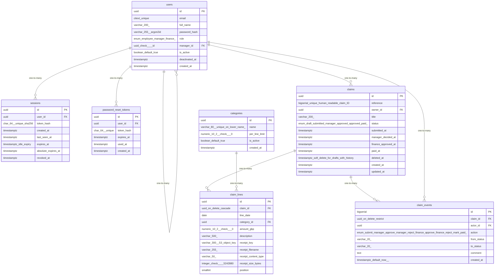

# Data Model

<!-- sdlc:auto:start entities -->
### users

| Field | Type | PK | FK | Nullable |
|---|---|---|---|---|
| id | uuid | True | — | False |
| email | citext unique | False | — | False |
| full_name | varchar(200) | False | — | False |
| password_hash | varchar(255) argon2id | False | — | True |
| role | enum(employee,manager,finance) | False | — | False |
| manager_id | uuid check <> id | False | users.id | True |
| is_active | boolean default true | False | — | False |
| deactivated_at | timestamptz | False | — | True |
| created_at | timestamptz | False | — | False |

### sessions

| Field | Type | PK | FK | Nullable |
|---|---|---|---|---|
| id | uuid | True | — | False |
| user_id | uuid | False | users.id | False |
| token_hash | char(64) unique sha256 | False | — | False |
| created_at | timestamptz | False | — | False |
| last_seen_at | timestamptz | False | — | False |
| expires_at | timestamptz idle expiry | False | — | False |
| absolute_expires_at | timestamptz | False | — | False |
| revoked_at | timestamptz | False | — | True |

### password_reset_tokens

| Field | Type | PK | FK | Nullable |
|---|---|---|---|---|
| id | uuid | True | — | False |
| user_id | uuid | False | users.id | False |
| token_hash | char(64) unique | False | — | False |
| expires_at | timestamptz | False | — | False |
| used_at | timestamptz | False | — | True |
| created_at | timestamptz | False | — | False |

### categories

| Field | Type | PK | FK | Nullable |
|---|---|---|---|---|
| id | uuid | True | — | False |
| name | varchar(80) unique on lower(name) | False | — | False |
| per_line_limit | numeric(10,2) check > 0 | False | — | True |
| is_active | boolean default true | False | — | False |
| created_at | timestamptz | False | — | False |

### claims

| Field | Type | PK | FK | Nullable |
|---|---|---|---|---|
| id | uuid | True | — | False |
| reference | bigserial unique human-readable claim ID | False | — | False |
| owner_id | uuid | False | users.id | False |
| title | varchar(200) | False | — | True |
| status | enum(draft,submitted,manager_approved,approved,paid) | False | — | False |
| submitted_at | timestamptz | False | — | True |
| manager_decided_at | timestamptz | False | — | True |
| finance_approved_at | timestamptz | False | — | True |
| paid_at | timestamptz | False | — | True |
| deleted_at | timestamptz soft delete for drafts with history | False | — | True |
| created_at | timestamptz | False | — | False |
| updated_at | timestamptz | False | — | False |

### claim_lines

| Field | Type | PK | FK | Nullable |
|---|---|---|---|---|
| id | uuid | True | — | False |
| claim_id | uuid on delete cascade | False | claims.id | False |
| line_date | date | False | — | False |
| category_id | uuid | False | categories.id | False |
| amount_gbp | numeric(10,2) check > 0 | False | — | False |
| description | varchar(500) | False | — | False |
| receipt_key | varchar(300) S3 object key | False | — | True |
| receipt_filename | varchar(255) | False | — | True |
| receipt_content_type | varchar(50) | False | — | True |
| receipt_size_bytes | integer check <= 5242880 | False | — | True |
| position | smallint | False | — | False |

### claim_events

| Field | Type | PK | FK | Nullable |
|---|---|---|---|---|
| id | bigserial | True | — | False |
| claim_id | uuid on delete restrict | False | claims.id | False |
| actor_id | uuid | False | users.id | False |
| action | enum(submit,manager_approve,manager_reject,finance_approve,finance_reject,mark_paid) | False | — | False |
| from_status | varchar(20) | False | — | False |
| to_status | varchar(20) | False | — | False |
| comment | text | False | — | True |
| created_at | timestamptz default now() | False | — | False |
<!-- sdlc:auto:end entities -->

<!-- sdlc:auto:start relationships -->
| Source | Target | Type |
|---|---|---|
| users | users | one-to-many |
| users | sessions | one-to-many |
| users | password_reset_tokens | one-to-many |
| users | claims | one-to-many |
| claims | claim_lines | one-to-many |
| categories | claim_lines | one-to-many |
| claims | claim_events | one-to-many |
| users | claim_events | one-to-many |
<!-- sdlc:auto:end relationships -->

<!-- sdlc:auto:start er-diagram -->

<!-- sdlc:auto:end er-diagram -->
