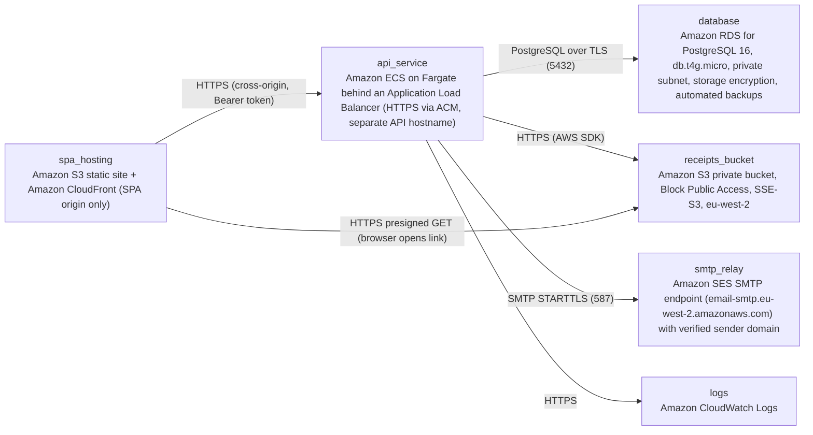

# Deployment Guide

> Maintained by QuorQ AI SDLC. Text between `sdlc:auto` markers is regenerated; anything outside them is yours and is kept.

<!-- sdlc:auto:start how-it-deploys -->
Pushes to `main` run `.github/workflows/deploy.yml`, which builds the API image (if there is a backend) and deploys the SPA to AWS Amplify. Commits touching only `docs/sdlc/**` don't deploy. Deployments can also be started from the platform's Deployment tab.
<!-- sdlc:auto:end how-it-deploys -->

<!-- sdlc:auto:start environments -->
| Name | Service | Runtime | Scaling | Environment |
|---|---|---|---|---|
| spa_hosting | Amazon S3 static site + Amazon CloudFront (SPA origin only) | Static React 19 build with VITE_API_BASE_URL set at build time | Managed CDN | dev |
| api_service | Amazon ECS on Fargate behind an Application Load Balancer (HTTPS via ACM, separate API hostname) | FastAPI 0.115 container (uvicorn), 0.5 vCPU / 1 GB, eu-west-2 | 1 task (desired count 1), no autoscaling (NFR-012) | dev |
| database | Amazon RDS for PostgreSQL 16, db.t4g.micro, private subnet, storage encryption, automated backups | PostgreSQL 16 | Single-AZ, vertical only | dev |
| receipts_bucket | Amazon S3 private bucket, Block Public Access, SSE-S3, eu-west-2 | Object storage | Managed | dev |
| smtp_relay | Amazon SES SMTP endpoint (email-smtp.eu-west-2.amazonaws.com) with verified sender domain | SMTP over STARTTLS port 587 | Managed | dev |
| logs | Amazon CloudWatch Logs | Container stdout, including email-failure logs | Managed | dev |
<!-- sdlc:auto:end environments -->

<!-- sdlc:auto:start live -->
_Not deployed yet._
<!-- sdlc:auto:end live -->

<!-- sdlc:auto:start topology -->

<!-- sdlc:auto:end topology -->
